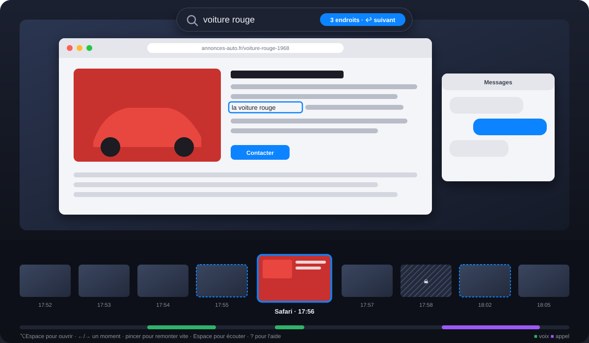
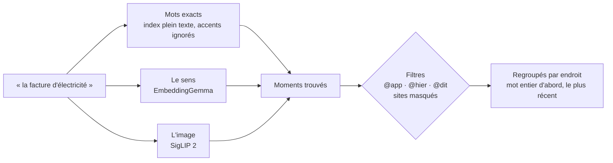
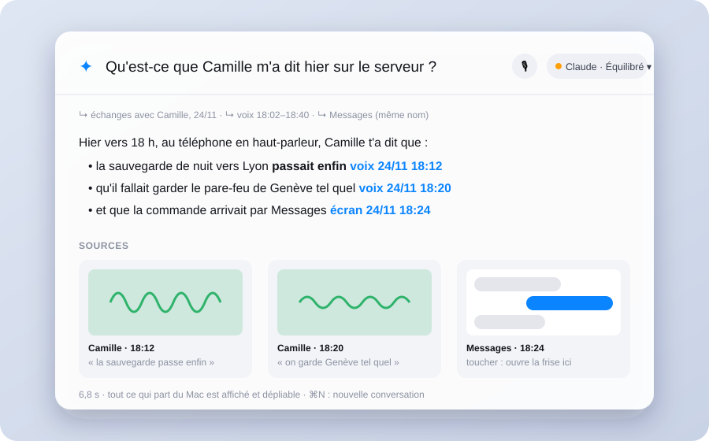
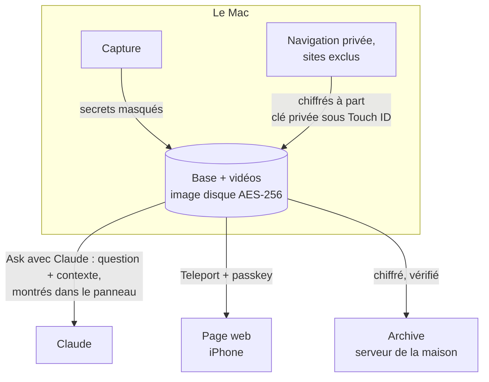
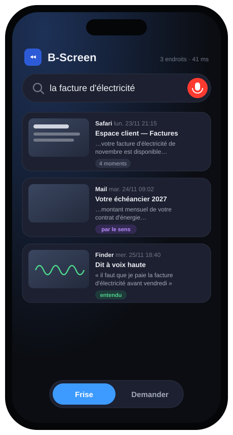
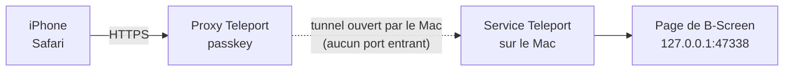
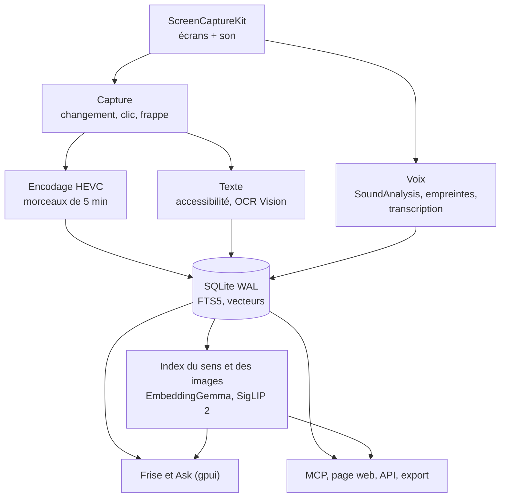

<div align="center">


# B-Screen

**Back Screen !** La mémoire de ton Mac : tout ce qui est passé à l'écran et tout ce qui a été dit,<br>
retrouvable en quelques millisecondes, sans que rien ne quitte le Mac.


[Ce que ça fait](#ce-que-ça-fait) · [La frise](#la-frise) · [Chercher](#chercher) · [Ask](#ask) · [Les voix](#les-voix) · [Vie privée](#vie-privée-et-sécurité) · [iPhone](#depuis-liphone) · [Réglages](#les-réglages) · [Sous le capot](#sous-le-capot) · [Installer](#installer-et-fabriquer)

</div>

<p align="center"></p>

> [!NOTE]
> Inspiré de [Rewind](https://www.rewind.ai), réécrit de zéro en Rust pour macOS. L'interface est dessinée avec [gpui](https://www.gpui.rs), les briques d'Apple sont appelées par [objc2](https://github.com/madsmtm/objc2). Un projet personnel, partagé tel quel.

---

## Ce que ça fait

| | |
|---|---|
| 🎞️ **Tout l'écran, tout le temps** | Une image toutes les 2 s au plus, seulement quand l'écran change, tout de suite après un clic ou une pause de frappe. Vidéo HEVC : ≈ 21 Ko par image, ≈ 5 Go par mois avec la voix. |
| 🔤 **Le texte de chaque image** | Lu par l'accessibilité de macOS (le vrai texte, au caractère près), l'OCR d'Apple en secours. Secrets masqués avant tout stockage. |
| 🎙️ **Les voix** | Micro et son du Mac, seulement quand quelqu'un parle (pas la musique), transcrits sur le Mac. Les voix familières sont reconnues et nommées. |
| 🕰️ **La frise** | ⌥Espace : revenir à n'importe quel instant, plein écran, au trackpad. Sélectionner le texte d'une vieille image, réécouter ce qui a été dit. |
| 🔎 **Trois recherches en une** | Les mots exacts, le **sens** (« la facture d'électricité » trouve « échéancier énergie ») et **ce qu'il y avait sur l'image** (« voiture rouge »). |
| ✦ **Ask** | ⌥⇧A : une question en français sur ta mémoire. Claude (par ton abonnement) ou un modèle local. Réponse avec renvois cliquables vers les moments, à la voix si tu veux. |
| 📱 **Depuis l'iPhone** | Une page web, derrière Teleport et ta passkey : chercher et demander à distance. |
| 🔒 **Privé par construction** | Données dans une image disque chiffrée, navigation privée sous Touch ID, sites et apps jamais enregistrés, rien ne sort sans le montrer. |

---

## La frise

**⌥Espace** depuis n'importe quelle app. L'écran d'un moment passé s'affiche en plein écran ; la bande de vignettes en bas défile au trackpad.

<details open>
<summary><b>Les gestes et les touches</b> (aussi dans la frise : touche <kbd>?</kbd>)</summary>

| Geste ou touche | Effet |
|---|---|
| <kbd>←</kbd> <kbd>→</kbd>, glisser au trackpad | un moment avant / après |
| Pincer | grossir ou réduire les vignettes ; en réduisant encore, **une vignette vaut jusqu'à 200 moments** pour remonter la journée vite |
| <kbd>⌘</kbd><kbd>←</kbd> <kbd>⌘</kbd><kbd>→</kbd> | jour précédent / suivant |
| <kbd>⌥</kbd><kbd>←</kbd> <kbd>⌥</kbd><kbd>→</kbd> | moment précédent / suivant où quelqu'un parlait |
| Taper une lettre | chercher (voir plus bas) ; <kbd>↩</kbd> / <kbd>⇧</kbd><kbd>↩</kbd> d'un endroit trouvé à l'autre, <kbd>Tab</kbd> la grille de tous les résultats |
| <kbd>Espace</kbd> | écouter ce qui a été dit à ce moment ; <kbd>↑</kbd> <kbd>↓</kbd> choisir le passage s'il y en a plusieurs |
| Glisser sur l'image, double-clic, triple-clic | sélectionner du texte (caractère, mot, ligne), comme dans un document |
| <kbd>⌘</kbd><kbd>C</kbd> · <kbd>⌘</kbd><kbd>O</kbd> | copier la sélection · rouvrir la page web ou le fichier |
| Clic sur « Voix 3 » | dire qui parle (seul ce passage change, la voix apprend) |
| <kbd>⌥</kbd><kbd>⌫</kbd>, <kbd>⌥</kbd>-clic puis <kbd>⌫</kbd> | supprimer un moment, une sélection de moments (avec confirmation) |
| Clic sur un moment hachuré 🔒 | voir la navigation privée (Touch ID) |
| <kbd>Échap</kbd> | fermer la recherche, la sélection, puis la frise |

Toutes les touches : [RACCOURCIS.md](RACCOURCIS.md).
</details>

---

## Chercher

Tape dans la frise (ou sur la page web) : trois recherches partent ensemble, et les résultats sont **regroupés par endroit** (une même page ou fenêtre à moins de 15 min, un même échange de voix) au lieu de 2 000 moments en vrac.



<details>
<summary><b>Les mots exacts, et pourquoi « le » ne donne rien</b></summary>

Un index plein texte (SQLite FTS5) de tout ce qui a été vu et dit, accents ignorés. Les mots entiers passent avant les débuts de mots (« bar » avant « barre »), classés par BM25.

Un mot présent dans plus de 2 % des textes (« le », « de », « un ») ne sert à rien pour chercher : il est **laissé de côté** s'il y a d'autres mots (« le voiture rouge » cherche « voiture rouge »), et seul il ne donne rien. C'est l'idée de l'IDF, avec les fréquences lues dans l'index lui-même.

Filtres : `@safari` (une app), `@hier`, `@lundi` (un jour), `@dit` (seulement ce qui a été dit).
</details>

<details>
<summary><b>Le sens (EmbeddingGemma)</b></summary>

Chaque texte d'au moins 3 mots reçoit un vecteur de 768 nombres (EmbeddingGemma de Google, converti pour Core ML, sur la carte graphique du Mac). La question aussi : les textes les plus proches remontent même sans un mot en commun.

L'index tient en mémoire sous forme compacte : le signe de chaque nombre, 96 octets par texte au lieu de 788. Les 1 000 meilleurs candidats sont départagés par leurs vrais vecteurs : sur de vraies recherches, 100 % des 20 premiers résultats retrouvés, en 1 ms pour 46 000 textes.
</details>

<details>
<summary><b>Ce qu'il y avait sur l'image (SigLIP 2)</b></summary>

Une image par scène (nouvelle app, fenêtre, page, ou la moitié de l'écran changée) passe par SigLIP 2 (Google, Apache 2.0) sur la puce neuronale : « voiture rouge », « un graphique des ventes », « une capture du terminal avec des erreurs » trouvent l'image même si rien de tel n'est écrit. Le modèle est multilingue : le français marche aussi bien que l'anglais.
</details>

---

## Ask

<p align="center"></p>

**⌥⇧A** (ou menu › Demander…) : un panneau façon Spotlight. B-Screen prépare le contexte **sur le Mac** (la période, l'activité, les voix, les textes proches par le sens, les personnes citées, les résumés de la nuit), puis le modèle répond au fil de l'eau.

| Modèle | Où | Ce qui sort du Mac |
|---|---|---|
| Rapide · Haiku, Équilibré · Sonnet, Approfondi · Opus | Claude, par ton abonnement (Claude Code) | la question et le contexte préparé, **affichés et dépliables** dans le panneau |
| Sur le Mac | qwen3.5:9b par Ollama | rien |

- Les renvois `[écran 24/11 18:24]` ouvrent la frise à ce moment ; les sources s'affichent en cartes.
- Questions de suite (⌘N pour repartir de zéro). Quand tu le corriges (« non, c'était mardi »), Ask **retient** le fait et le redonne à chaque question ; la liste est dans Réglages › Recherche.
- Claude n'a **qu'un seul outil** : la mémoire de B-Screen, en lecture seule. Ni fichiers, ni commandes, ni tes autres serveurs MCP.
- **Mode vocal** : 🎙 enregistre la question (transcrite sur le Mac), la réponse est lue à voix haute.

<details>
<summary><b>La nuit : résumés et phrases floues</b></summary>

Sur secteur et Mac inactif, le modèle local résume chaque épisode de la journée et relit les échanges de voix : « il est derrière le truc » devient « Le chargeur du Mac est derrière le support d'écran. » (l'original reste intact, la version déduite est cherchable). Rien ne sort du Mac. Réglages › Recherche › La nuit.
</details>

---

## Les voix

Le micro et le son du Mac sont écoutés en continu, mais **rien n'est gardé tant que personne ne parle** : SoundAnalysis trie la parole de la musique, l'écho des haut-parleurs est écarté. Chaque passage est compressé (AAC 16 kHz, ≈ 25 kbit/s), transcrit par la reconnaissance d'Apple **sur le Mac**, et sa voix reconnue par empreinte (Core ML).

- Les voix connues se nomment dans la frise ou dans Réglages › Voix (avec un passage à réécouter).
- Un **appel** (FaceTime, WhatsApp, Teams…) est reconnu : la voix d'en face est séparée de la tienne. Les appels peuvent aussi ne pas être enregistrés du tout (réglage).
- Le son d'une vidéo n'a pas de « voix » : il est rangé comme vidéo.

---

## Vie privée et sécurité



| Protection | Comment |
|---|---|
| **Chiffrement** | Toutes les données dans une image disque APFS chiffrée (AES-256), ouverte au lancement avec la clé du Trousseau ; une clé de secours a été montrée une fois. |
| **Navigation privée** | Reconnue dans Safari, Chrome, Firefox, Arc, Brave, Edge, Vivaldi, Opera, Zen, Tor (titre, insigne, et même en plein écran) : images verrouillées et chiffrées à part avec une clé publique ; la clé privée n'est lue qu'après Touch ID. Ni texte, ni adresse, ni voix gardés. |
| **Secrets masqués** | Cartes, IBAN, clés d'API, jetons, mots de passe affichés : remplacés avant tout stockage, et recouverts sur l'image. |
| **Sites et apps jamais enregistrés** | Gestionnaires de mots de passe toujours exclus ; tes propres apps et domaines dans les réglages. |
| **Effacer** | Les 5 dernières minutes, la dernière heure, aujourd'hui, ou des moments choisis : vraiment effacés (`secure_delete`, vidéos réencodées sans eux). |
| **Garde-fous** | Si la lecture du texte se bloque (Vision après une veille, vu le 24/11/2026), les images de navigateur de la période sont verrouillées par précaution et B-Screen se relance. |
| **Ce qui sort** | Seulement ce que tu demandes, et toujours montré : la question et le contexte d'Ask avec Claude, la page web à travers Teleport, l'archive chiffrée. |

---

## Depuis l'iPhone

<table>
<tr>
<td width="300"></td>
<td>

Une page web servie **par le Mac lui-même**, sur `127.0.0.1` ; pour l'ouvrir de dehors, on la publie derrière [Teleport](https://goteleport.com) (aucun port ouvert sur le Mac).

- **Frise** : la même recherche que sur le Mac, avec vignettes ; toucher une carte montre l'image en grand.
- **Demander** : Ask, la réponse au fil, renvois touchables.
- **À la voix** : un micro dans les deux champs ; une question dite reçoit sa réponse lue.
- **Qui peut l'ouvrir** : seulement les comptes Teleport que tu permets (un rôle réservé, ta passkey) ; chaque requête porte la signature du cluster, vérifiée par la page.
- **Rien de privé** : ni moment verrouillé, ni site masqué. Lecture seule.
- Le Mac doit être allumé et éveillé : aucune copie des données n'est ailleurs.

</td>
</tr>
</table>



---

## Les réglages

Menu › Réglages… (<kbd>⌘</kbd><kbd>,</kbd>) : tout ce qui y est affiché se règle.

<details>
<summary><b>Général</b></summary>

Enregistrer ou mettre en pause · mettre en pause pendant 15 min, 1 h ou jusqu'à demain 8 h · ouvrir à la connexion · écart entre deux images (1, 2, 5, 10 s) · raccourcis de la frise, d'Ask et de la pause (à taper) · autorisations de macOS · combien de temps garder.
</details>

<details>
<summary><b>Voix</b></summary>

Voix du micro · voix qui sortent du Mac · les appels · vocabulaire à bien reconnaître (prénoms, noms de projets) · voix connues à réécouter et nommer.
</details>

<details>
<summary><b>Confidentialité</b></summary>

Durée d'ouverture après Touch ID · secrets masqués · chiffrement · apps jamais enregistrées · sites jamais enregistrés · effacer (5 min, 1 h, aujourd'hui).
</details>

<details>
<summary><b>Recherche</b></summary>

Recherche par le sens · dans les images · texte hors de l'écran (gardé ou non) · indexation toutes les 5, 20 ou 60 min, sur batterie ou non · **sites montrés ou masqués dans la recherche** (tes sites les plus vus, chacun avec un interrupteur) · la nuit · modèle d'Ask · ce qu'Ask a retenu.
</details>

<details>
<summary><b>Autres programmes · Stockage</b></summary>

Serveur MCP pour Claude Code (commande à copier) · page web · API HTTP locale · archive sur un serveur (après 30, 60, 90 jours ou jamais) · place prise, processeur et mémoire de B-Screen.
</details>

---

## Sous le capot



<details>
<summary><b>Les crates</b></summary>

| Crate | Rôle |
|---|---|
| `bscreen-core` | portable : réglages, chemins, images, masquage des secrets, voix familières, index compact des vecteurs |
| `bscreen-store` | portable : la base SQLite (schéma 16) |
| `bscreen-api` | portable : MCP, contexte d'Ask, export JSON Lines, API HTTP |
| `bscreen-macos` | macOS : capture, vidéo, accessibilité, OCR, audio, transcription, Core ML, Touch ID, barre des menus |
| `bscreen-ui` | l'interface gpui : frise, Ask, réglages |
| `bscreen` | l'app, la page web et les commandes |
</details>

<details>
<summary><b>Les modèles, et ce qu'ils coûtent</b></summary>

| Modèle | Rôle | Où | Chargé |
|---|---|---|---|
| EmbeddingGemma (Google) | le sens | carte graphique | 204 Mo, seulement pour chercher, rendu après 1 min |
| SigLIP 2 base (Google, Apache 2.0) | les images | puce neuronale / processeur | 176 + 164 Mo |
| Empreintes de voix (CC-BY-4.0) | qui parle | Core ML | 15 Mo |
| Reconnaissance vocale d'Apple | transcription | sur le Mac | — |

Les deux modèles de texte n'ont plus leur table des mots (256 000 mots × 768 nombres) : elle est dans des fichiers `.mots` lus en mémoire projetée, ce qui divise par trois la mémoire prise. Crédits : [CREDITS.md](CREDITS.md).
</details>

<details>
<summary><b>Ce que ça coûte au Mac</b> (semaine de mesures, novembre 2026)</summary>

| | Mesuré | Objectif |
|---|---|---|
| Processeur, Mac au repos | 0,4 % d'un cœur | < 1 % |
| Processeur pendant un appel | 3,8 % | < 15 % |
| Vidéo et voix | ≈ 160 Mo par jour, ≈ 5 Go par mois | < 10 Go par mois |
| Relire une image dans la frise | 47 ms (médiane) | < 50 ms |
| Chercher | ≈ 40 ms, 70-80 ms la première fois | < 100 ms |

Relevés toutes les 10 minutes (seulement des chiffres) : `bscreen mesures`.
</details>

<details>
<summary><b>L'archive sur un serveur de la maison</b></summary>

Chaque nuit, sur secteur, les vidéos et la voix de plus de 30 jours partent sur un serveur joignable par Teleport : chiffrées (AES-256-GCM, clé tirée de la clé de secours), vérifiées par empreinte, puis effacées du Mac. L'index, le texte et une vignette par scène restent ; revoir ou réécouter un moment archivé le ramène.
</details>

---

## Installer et fabriquer

```bash
scripts/empaqueter.sh --lancer     # fabrique, signe, installe dans ~/Applications et lance
cargo test --workspace
scripts/modeles.sh                 # modèles d'empreintes de voix (vérifiés par SHA-256)
```

<details>
<summary><b>Les modèles de recherche</b> (hors du dépôt, une fois)</summary>

Dans `outils/coreml` (environnement `uv`) :

```bash
.venv/bin/python convertir.py                     # EmbeddingGemma (128 jetons) + EmbeddingGemma.mots
hf download google/siglip2-base-patch16-256 --local-dir modele-siglip2
.venv/bin/python convertir_siglip.py              # SigLIP2-Image, SigLIP2-Texte + SigLIP2-Texte.mots
xcrun coremlcompiler compile EmbeddingGemma-128-fpmixte-fixe.mlpackage /tmp/c && mv /tmp/c/*.mlmodelc ../../assets/modeles/EmbeddingGemma.mlmodelc
xcrun coremlcompiler compile SigLIP2-Image.mlpackage ../../assets/modeles/
xcrun coremlcompiler compile SigLIP2-Texte.mlpackage ../../assets/modeles/
cp modele-siglip2/tokenizer.json ../../assets/modeles/SigLIP2.tokenizer.json
cp EmbeddingGemma.mots SigLIP2-Texte.mots ../../assets/modeles/
```
</details>

<details>
<summary><b>Régler la page web et l'archive</b></summary>

Dans `reglages.json` (dans les données) :

```json
{
  "page_web": true,
  "page_web_nom": "bscreen.exemple.fr",
  "page_web_proxy": "proxy.exemple.fr",
  "page_web_comptes": ["moi"],
  "archive_proxy": "proxy.exemple.fr:443",
  "archive_hote": "bscreen@archive"
}
```

- **Page web** : un service d'application Teleport sur le Mac (`app_service`, `uri: http://127.0.0.1:47338`, `public_addr` = `page_web_nom`) rejoint le cluster par un tunnel sortant ; donne l'accès à un seul rôle, et exclus son étiquette des rôles partagés.
- **Archive** : un robot Teleport (Machine ID) dont l'identité est dans `~/.tbot/bscreen/identity`, limité à un compte sans root sur la machine d'archive.
</details>

<details>
<summary><b>Brancher la mémoire dans Claude Code</b></summary>

```bash
claude mcp add b-screen -- ~/Applications/B-Screen.app/Contents/MacOS/bscreen mcp
```

Outils en lecture seule : `chercher`, `chercher_par_le_sens`, `chercher_dans_les_images`, `activite`, `voix`, `echanges`, `recherches`, `ecran`.
</details>

<details>
<summary><b>Les commandes</b></summary>

Le binaire : `~/Applications/B-Screen.app/Contents/MacOS/bscreen`.

| Commande | Ce qu'elle fait |
|---|---|
| `bscreen mcp` | serveur MCP en lecture seule |
| `bscreen chercher "texte"` | la recherche de la frise, avec ses temps |
| `bscreen contexte "question"` · `bscreen essai-ask "question"` | le contexte qu'Ask préparerait · poser la question comme le panneau |
| `bscreen export [jour] [fichier]` | une journée en JSON Lines |
| `bscreen bilan [jours]` · `bscreen mesures [jours]` | ce qui a été enregistré · la semaine de mesures face aux objectifs |
| `bscreen chiffrement` · `migrer` · `effacer-clair` | l'image chiffrée |
| `bscreen ranger-prive [--a-blanc]` | chiffrer à part les moments privés encore dans les vidéos |
| `bscreen corrections [--oublier N]` | ce qu'Ask a retenu |
| `bscreen archive` · `archiver` · `archive-essai` | l'archive sur un serveur |
| `bscreen indexer-sens` · `indexer-images` | indexer tout de suite |
| `bscreen essai-sens` · `essai-images` · `essai-index` · `verifier-sens` | essayer et vérifier la recherche par le sens et dans les images |
| `bscreen banc-d-essai [--reponses] [--nuit]` | le banc d'essai de la recherche, sur une semaine inventée |
| `bscreen essai-lecture <vidéo>` · `essai-voix` · `essai-ocr` · `essai-selection` | bancs d'essai de la lecture des images, des voix, de l'OCR |
| `bscreen rattraper-texte` · `retrier-voix` | relire par l'OCR les images sans texte · retrier les voix du passé |
| `bscreen chemins` | où sont les données, réglages et journaux |
</details>

<details>
<summary><b>Où sont les données</b></summary>

Dans l'image chiffrée, ouverte sur `~/Library/Application Support/B-Screen-volume/` : `index.sqlite`, `video/`, `audio/`, `prive/` (chiffré à part), `reglages.json`. Journal : `~/Library/Logs/B-Screen/bscreen.log` ; mesures : `~/Library/Logs/B-Screen/mesures.jsonl`.
</details>

---

<details>
<summary><b>Questions</b></summary>

**Est-ce que ça ralentit le Mac ?** Au repos, moins d'un demi-pourcent d'un cœur ; les modèles ne se chargent qu'au moment de chercher et repartent une minute après.

**Et si je regarde un film en navigation privée en plein écran ?** Verrouillé : une fenêtre de navigateur sans titre garde l'état privé de juste avant.

**Je peux le couper un moment ?** Pause dans le menu, ou « Mettre en pause pendant 15 min / 1 h / jusqu'à demain », ou ton raccourci de pause.

**Où vont mes questions à Ask ?** Avec Claude : la question et le contexte préparé, tous deux affichés dans le panneau. Avec le modèle « Sur le Mac » : nulle part.

**Et l'iPhone, il est enregistré ?** Non (iOS ne le permet pas toute la journée) : la page web permet de chercher dans la mémoire du Mac depuis l'iPhone.
</details>

<p align="center"><sub>Fait par <a href="https://github.com/bini74">bini74</a> pour son Mac. Ce dépôt ne contient aucune donnée personnelle.</sub></p>
